# Real2Sim2Real on a low-cost SO-101 arm

**Phone video in. Simulator in the middle. Real robot out.**

<p align="center">
  
</p>

A low-cost [SO-101](https://github.com/TheRobotStudio/SO-ARM100) arm learns to put a 30 mm cube into a cup.
Trained on 40 real demonstrations alone, it handles cubes where those demos are dense and fails where they are
thin, like a cube on its right near the base. **Simulation fills the gaps.** A 45-second phone video of the desk
becomes a Gaussian splat. The splat becomes the background of an Isaac Sim scene calibrated to the real cameras,
and the simulator produces thousands of randomized demonstrations across the whole desk, more than 1,200 of them rendered inside the splat. Co-trained on both, the same
model succeeds in **19 of 21 real runs**, against **6 of 21** for the real-only versions. It runs on a Jetson Orin Nano
next to the arm.

<p align="center">
  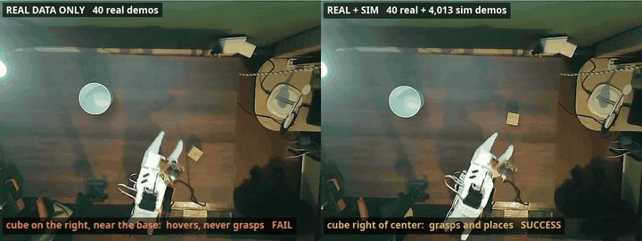
  <br><sub>Real arm, real time, overhead camera. Same ACT model and 80k training steps. <b>Left:</b> 40 real demos only, cube on the right near the base: it hovers and never grasps. <b>Right:</b> the same 40 real demos plus 4,013 sim episodes: it grasps and places.</sub>
</p>

▶ **Videos:** [55 s highlight reel](docs/media/videos/00_reel.mp4) · one video per pipeline step, linked in each section below.

---

## Contents

- [Results](#results)
- [Why the sim data helped: where the real data runs out](#why-the-sim-data-helped-where-the-real-data-runs-out)
- [The pipeline](#the-pipeline)
  1. [Capture the real workspace](#1-capture-the-real-workspace)
  2. [Reconstruct it as a Gaussian splat](#2-reconstruct-it-as-a-gaussian-splat)
  3. [Align the simulator with the real rig](#3-align-the-simulator-with-the-real-rig)
  4. [Generate demonstrations in simulation](#4-generate-demonstrations-in-simulation)
  5. [Teach recovery with takeovers](#5-teach-recovery-with-takeovers)
  6. [Audit the data before training on it](#6-audit-the-data-before-training-on-it)
  7. [Collect real demonstrations](#7-collect-real-demonstrations)
  8. [Co-train and iterate](#8-co-train-and-iterate)
  9. [Evaluate in simulation](#9-evaluate-in-simulation)
  10. [Deploy on the real arm](#10-deploy-on-the-real-arm)
- [The Jetson: `so101.sh` and the web console](#the-jetson-so101sh-and-the-web-console)
- [Hardware](#hardware)
- [Repository layout](#repository-layout)
- [Running it](#running-it)
- [What made it work](#what-made-it-work)
- [Next](#next)

---

## Results

| | |
|---|---|
| **88%** | sim success on 50 held-out randomized scenes (ACT v4, 80k steps) |
| **19 / 21** | real-arm runs with the co-trained policy, over three sessions (2 / 2, 3 / 4, 14 / 15) |
| **6 / 21** | real-arm runs for the real-only baselines (same 40 real demos) |
| **336 vs 4** | sim episodes vs real demos within 5 cm of the spot where the real-only policy failed |
| **4,013 + 40** | sim + real demos behind the co-trained policy |
| **40 ms** | ACT inference per action chunk on the Jetson Orin Nano (fp16 + CUDA graphs; 72 ms in fp32) |

Sim numbers are 50 randomized episodes per policy. The sim was rebuilt twice (recalibrated cameras and joints,
wider spawns, then spawns limited to the real desk), so compare rows within a build.

| Policy | Training data | Sim success | Real arm |
|---|---|---|---|
| ***Sim build 1: first cameras, three cube sizes*** | | | |
| ACT v0 | 200 expert demos | 28% | – |
| ACT v1 | 400 demos, expert without idle waits | 62% | – |
| ACT v2 | + 300 recovery takeovers | 84% | – |
| SmolVLA v2 | same 700 episodes, 10-step chunks | 94% | – |
| ***Sim build 2: recalibrated cameras and joints, 30 mm cube, wide spawns*** | | | |
| ACT v3a | 1,000 expert + 10 real | 80% | hovers near the demo region |
| SmolVLA v3a | same | 68% | – |
| ACT v4, 40k steps | + splat DART demos, takeovers, 40 real | 70% plain · 74% splat | – |
| ***Sim build 3: spawns limited to the real desk*** | | | |
| **ACT v4, 80k steps** | same as above (trained before the desk fix) | **88%** | **19 / 21** |
| ACT v4b, 40k steps | off-desk episodes removed | 72% | – |
| ***Real data only*** | | | |
| ACT real-only | 10 real demos | – | 0 / 2 |
| ACT real-only, 40k steps | 40 real demos | – | 4 / 16 |
| ACT real-only, 80k steps | 40 real demos | – | 2 / 5 |

<p align="center">
  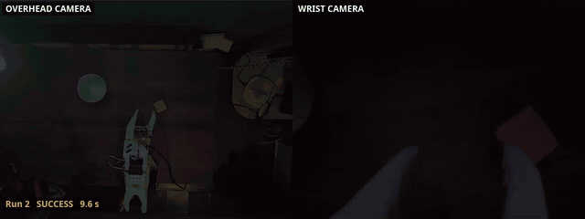
  <br><sub>The co-trained policy on the real arm (overhead + wrist camera, real time, 9.6 s). <a href="docs/media/videos/10_real_arm.mp4">▶ Full step-10 video</a>: the comparison, then three successful runs.</sub>
</p>

Cube and cup were placed by hand, not on a fixed grid, and run times end when the operator labels the run. The console recorded every co-trained run after the first session (19 of 21) and the last two real-only runs
(both cameras, joint states, the label).

---

## Why the sim data helped: where the real data runs out

<p align="center">
  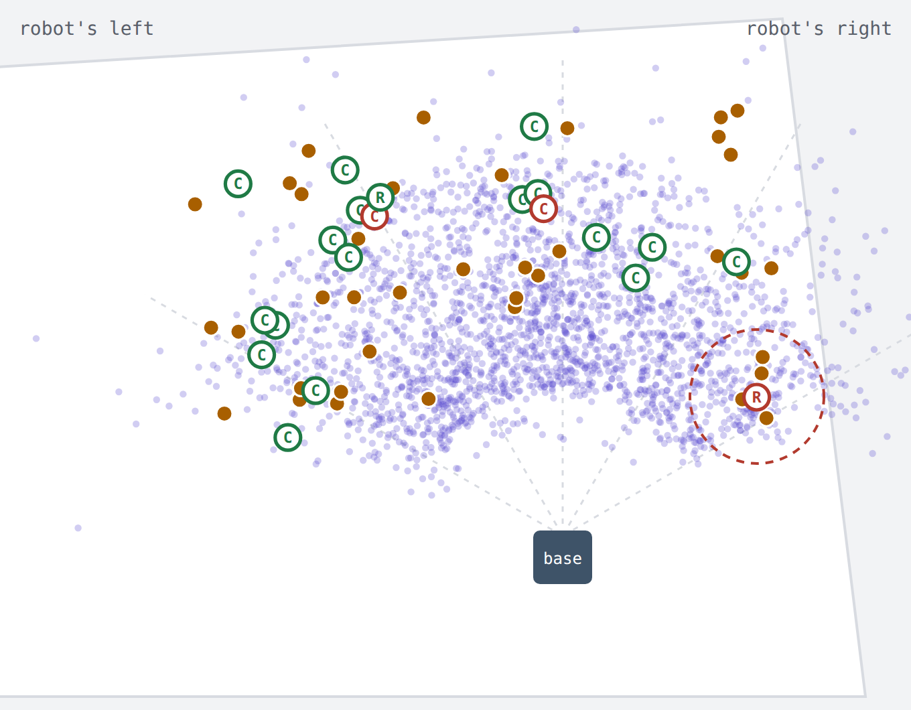
</p>

Each dot is the cube's position at the moment of the grasp in one training episode. It is computed from the arm's
joint readings with forward kinematics ([`analysis/real_positions.py`](analysis/real_positions.py),
[`analysis/train_positions.py`](analysis/train_positions.py)) and seen from above with the robot at the bottom.
Violet dots are sim episodes (2,400 of 3,992 drawn) and amber dots are real demos. The rings are the 21 recorded real runs (2 real-only, 19 co-trained):
**R** real-only, **C** real + sim, green for success and red for fail. The dashed circle is 5 cm around where the
real-only hand hovered.

| | real demos | sim episodes |
|---|---|---|
| cube on the robot's right | 13 of 39 (33%) | 44% |
| within 5 cm of the real-only failure | **4** | **336** |

The real demos cluster on the robot's left and leave gaps on the right. The real-only policy failed in one of those
gaps: it reached the cube, hovered, and never closed the gripper. The randomized sim spawns cover the whole desk,
and the co-trained policy grasped the cube in all 21 of its runs and placed it in 19. Its successful runs were also
shorter: 14.2 s on average against 17.5 s for the real-only policies.

*Caveat:* the co-trained policy succeeded with cubes up to 32° right of center but has not yet been tried at the exact
spot of the real-only failure (54° right, close to the base). That run is the next test. Sim points past the right
edge of the desk are spawns that the desk fix ([step 6](#6-audit-the-data-before-training-on-it)) removed from
later data.

---

## The pipeline

```mermaid
flowchart LR
  A["01 Phone<br/>capture"] --> B["02 Gaussian<br/>splat"] --> C["03 Real-to-sim<br/>alignment"] --> D["04 Sim<br/>demos"] --> E["05 Recovery<br/>data"]
  E --> F["06 Data<br/>audit"] --> G["07 Real<br/>demos"] --> H["08 Train &<br/>iterate"] --> I["09 Sim<br/>eval"] --> J["10 Real arm<br/>deploy"]
  classDef real fill:#F5A524,stroke:#A85F00,color:#101216
  classDef sim fill:#B4A4F5,stroke:#5B4BCF,color:#101216
  classDef comp fill:#9FB4C8,stroke:#3E5368,color:#101216
  class A,G,J real
  class B,C,D,E,I sim
  class F,H comp
```

<sub>Amber: real world · violet: simulation · grey: data and compute.</sub>

### 1. Capture the real workspace

One handheld phone pass around the desk, the arm, the cup and both robot cameras. No scanner, no markers. This
video is the only input to the 3D reconstruction.

- iPhone HLG/BT.2020 HDR, tone-mapped to SDR (zscale + Hable) before any frame is used.
- The sharpest frame in each time window is kept ([`splat/select_frames.py`](splat/select_frames.py)).
  Structure-from-motion (COLMAP via pycolmap) recovers the camera poses ([`splat/run_sfm.py`](splat/run_sfm.py),
  [`splat/plot_sfm.py`](splat/plot_sfm.py)).

**Input:** 45 s, 1080×1920, 60 fps · **Cost:** one minute of filming ·
[▶ step video](docs/media/videos/01_capture.mp4)

### 2. Reconstruct it as a Gaussian splat

<p align="center">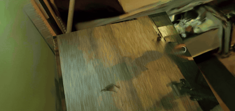</p>

The frames and poses train a 3D Gaussian splat with [gsplat](https://github.com/nerfstudio-project/gsplat). The
volume over the desk and around the robot base is cropped out, and the rest is converted to a USD ParticleField. Isaac
Sim's RTX renderer then draws the real room around the simulated desk top, robot, cube and cup
([`calib/export_splat.py`](calib/export_splat.py)).

- Everything the policy touches is a physics object, so it can move and be randomized. The splat supplies
  everything else the cameras see.
- The splat is aligned in the robot frame and colour-matched to the real cameras (step 3).
- The orbit above is rendered by a small CPU-only 3DGS renderer written for the report
  ([`report/splat_render/splatcpu.py`](report/splat_render/splatcpu.py)).

**Gaussians:** 346,881 (SH degree 3) · **Stack:** gsplat 1.6 → omni.kit.converter.gsplat → Isaac Sim 6.1 ·
[▶ step video](docs/media/videos/02_splat.mp4)

### 3. Align the simulator with the real rig

<p align="center">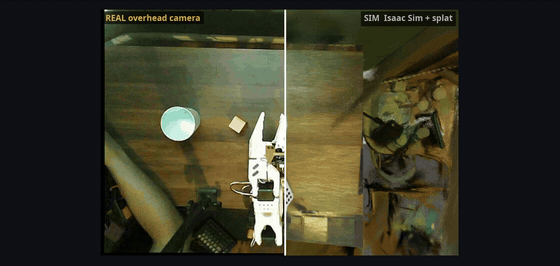</p>

A policy only transfers if the simulated cameras see what the real ones see. Every camera and joint was measured, and
the sim was corrected to match.

- **Lens calibration** with a ChArUco board shown on a phone screen (no printer):
  [`calib/boards.py`](calib/boards.py), [`calib/capture.py`](calib/capture.py), [`calib/solve.py`](calib/solve.py).
  The wrist camera has a 60° field of view and strong barrel distortion, against 87° in the stock sim asset. Real
  frames are undistorted before the policy sees them
  ([`scripts/undistort_real_dataset.py`](scripts/undistort_real_dataset.py)).
- **Overhead camera pose**, solved with the robot itself as the target: arm poses, forward kinematics and silhouettes
  ([`calib/silhouette.py`](calib/silhouette.py), [`calib/fk.py`](calib/fk.py)). The camera sits about 1.4 m above
  the desk, not the assumed 0.85 m.
- **Joint zero offsets** (up to 4.5°), found by replaying recorded real episodes in sim
  ([`scripts/replay_real.py`](scripts/replay_real.py)).
- **Splat pose and colour:** position, rotation and scale, plus a per-channel colour gain, fitted against the real
  overhead frame ([`calib/align_splat.py`](calib/align_splat.py),
  [`calib/refine_splat_align.py`](calib/refine_splat_align.py)).
- **Wrist-camera mount** refitted from the jaws seen in the real wrist image ([`calib/wrist_mount.py`](calib/wrist_mount.py),
  [`scripts/check_wrist_mount.py`](scripts/check_wrist_mount.py)), since the stock mount didn't match this rig.

The results live in [`calib/data/calib.json`](calib/data/calib.json) and are read by
[`so101_r2s2r/calib.py`](so101_r2s2r/calib.py). [▶ step video](docs/media/videos/03_real2sim.mp4)

### 4. Generate demonstrations in simulation

<p align="center">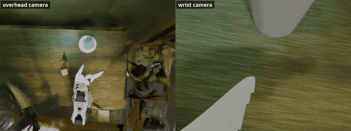</p>

A scripted expert solves the task in Isaac Lab with full knowledge of the state, while the cameras record what a
policy would see ([`so101_r2s2r/env_cfg.py`](so101_r2s2r/env_cfg.py), [`so101_r2s2r/mdp.py`](so101_r2s2r/mdp.py),
[`so101_r2s2r/expert.py`](so101_r2s2r/expert.py), [`scripts/record_demos.py`](scripts/record_demos.py)).

- **Expert:** a state machine (pre-grasp, descend, grasp, rise, transport, release) that advances when the arm
  settles, not on fixed timers. That change, together with doubling to 400 demos, took ACT from 28% to 62%.
- **Domain randomization** each episode: cube and cup pose on the real desk, lighting, desk texture, splat colour,
  camera pose jitter and friction.
- **DART noise:** the executed actions are perturbed, but the recorded labels are the expert's clean corrections,
  so the demos contain small recoveries for free.
- Recordings are converted to LeRobot v3 datasets with exactly the schema of the real recorder
  ([`scripts/convert_to_lerobot.py`](scripts/convert_to_lerobot.py)).

**v4 batch:** 1,251 splat-background expert demos · **Compute:** 6 cloud A6000s in parallel (Isaac RTX rendering needs
RT cores; about 20 env-steps/s per GPU), orchestrated by [`cloud/`](cloud) ·
[▶ step video](docs/media/videos/04_sim_demos.mp4)

### 5. Teach recovery with takeovers

<p align="center">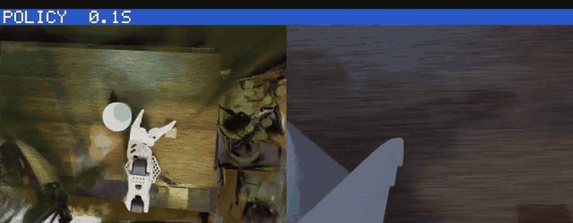</p>

Behaviour cloning fails by drifting into states the expert never visits: a missed grasp, a dropped cube, hovering. To
cover those states, a trained policy drives and the expert takes over when the policy fails (DAgger-style,
[`scripts/record_takeover.py`](scripts/record_takeover.py)). Isaac can't import LeRobot, so the policy is served over a
local socket ([`scripts/policy_server.py`](scripts/policy_server.py)).

- Takeover triggers: hovering without progress, a dropped cube, an empty grasp, time-outs.
- Only the expert's recovery is a training label; the policy's own mistakes just set up the situation.

**v4 batch:** 762 takeover episodes · **Effect:** in the first sim build, +300 takeovers took ACT from 62% to 84% ·
[▶ step video](docs/media/videos/05_recovery.mp4)

### 6. Audit the data before training on it

A visual review of generated scenes showed cups spawning partly or fully off the real desk. The sim's physics desk is
larger than the real one, so those demos taught behaviour that can't exist in the real world.

- **Fix:** spawns are sampled inside the measured desk polygon, with the cup at least 5.5 cm and the cube at least
  3 cm from the edge (`DESK_POLY` in [`so101_r2s2r/env_cfg.py`](so101_r2s2r/env_cfg.py), checked by
  [`analysis/sampler_check.py`](analysis/sampler_check.py) and [`analysis/desk_grid.py`](analysis/desk_grid.py)). All
  evaluations since use the fixed sampler.
- A cleaned training mix (v4b) drops every episode with an invalid spawn instead of keeping it as noise
  ([`cloud/v4b_flag.py`](cloud/v4b_flag.py), [`cloud/v4b_build.py`](cloud/v4b_build.py)).
- Other catches: the first frame after a reset showed the previous episode's render; a dataset-merge bug wrote bad
  file indices; a mixed-precision flag silently did nothing.

**Dropped:** 1,509 of 4,013 sim episodes (37.6%) · [▶ step video](docs/media/videos/06_data_audit.mp4)

### 7. Collect real demonstrations

<p align="center">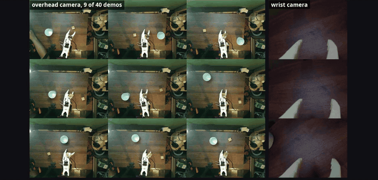</p>

40 demos were teleoperated with a leader arm that the follower mirrors. They were recorded on the Jetson through the
web console built for this project ([`jetson/so101_web/recorder.py`](jetson/so101_web/recorder.py)), in LeRobot v3
format with wrist and overhead cameras.

- The first 10 demos all had the cube on the left, and a policy trained on them learned exactly that bias.
- The next 30 spread out, but the set still leans left: 26 of the 39 measured cube positions are on the robot's left,
  and only 4 sit near the right-hand spot where the real-only policy later failed
  ([map](#why-the-sim-data-helped-where-the-real-data-runs-out)).

**Size:** 40 episodes, 14,704 frames (8.2 min) at 30 fps · **Cameras:** wrist (Innomaker U20CAM) + overhead
(Orbbec Astra Pro), 640×480 · [▶ step video](docs/media/videos/07_real_demos.mp4)

### 8. Co-train and iterate

<p align="center">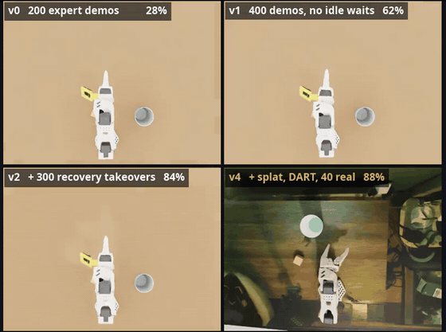</p>

ACT (Action Chunking Transformer: ResNet-18 + CVAE, predicts 50 future actions and executes 30) is co-trained on sim
and real data. Real episodes are upweighted so they make up about a quarter of all frames
([`cloud/v4_aggregate.py`](cloud/v4_aggregate.py), [`cloud/v4_train.sh`](cloud/v4_train.sh),
[`cloud/v4_final.sh`](cloud/v4_final.sh); real-only baseline: [`cloud/real40_train.sh`](cloud/real40_train.sh)).

- Each data change was measured in sim before moving on (above: the same scene, four policy generations).
- Also trained and compared: SmolVLA (a 450M vision-language-action model) and NVIDIA GR00T N1.7 (3B), fine-tuned on
  H100s ([`cloud/groot_setup.sh`](cloud/groot_setup.sh), [`cloud/groot_train.sh`](cloud/groot_train.sh)).

**v4 mix:** 4,013 sim + 40 real (×19), 1.10M frames, 25% real · **v4b mix:** 2,504 cleaned sim + 40 real (×11),
666k frames · **Training:** 80k steps, batch 16, bf16, one H100 (0.081 s/step, 2.1× an A6000) ·
[▶ step video](docs/media/videos/08_iterations.mp4)

### 9. Evaluate in simulation

<p align="center">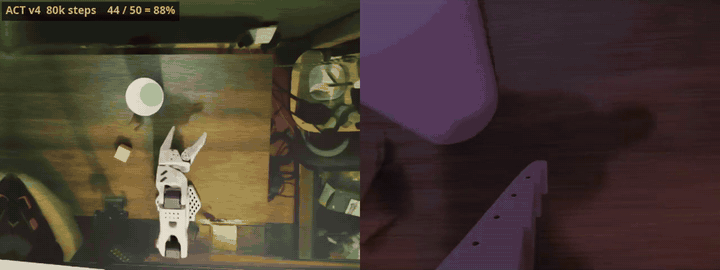</p>

Every checkpoint runs 50 held-out randomized scenes ([`scripts/eval_policy.py`](scripts/eval_policy.py),
[`cloud/eval_v4.sh`](cloud/eval_v4.sh), [`cloud/eval_v4b.sh`](cloud/eval_v4b.sh)). Each episode is scored as success,
time-out or tipped cup, and the failures are sorted by cause, because the cause picks the next data fix.

| | |
|---|---|
| ACT v4 80k | **44 / 50 = 88%** |
| by cup distance | 15–20 cm 11/12 · 20–25 cm 7/7 · 25–30 cm 21/23 · 30–35 cm 5/8 |
| failures | 3 cube knocked out of reach · 2 cube dropped on the rim of a far-left cup · 1 empty grasp with no retry |

The rim drop showed up on the real arm too (step 10). [▶ step video](docs/media/videos/09_sim_eval.mp4)

### 10. Deploy on the real arm

<p align="center"></p>

The same ACT model goes on the arm trained two ways: on the 40 real demos only (checkpoints at 40k and 80k steps), and on the same 40 plus 4,013 sim episodes (80k steps). The side-by-side video compares the two 80k-step policies.

- **Real only:** it succeeded in 6 of 21 runs. In the recorded failure, with the cube on its right near the base, it hovered and never closed the gripper. Only 4 real demos are within 5 cm of that spot.
- **Real + sim:** it grasped the cube in all 21 runs and placed it in 19, on both sides of the desk. Both misses
  bounced off the cup rim; in one, it picked the cube back up and tried again.

<p align="center">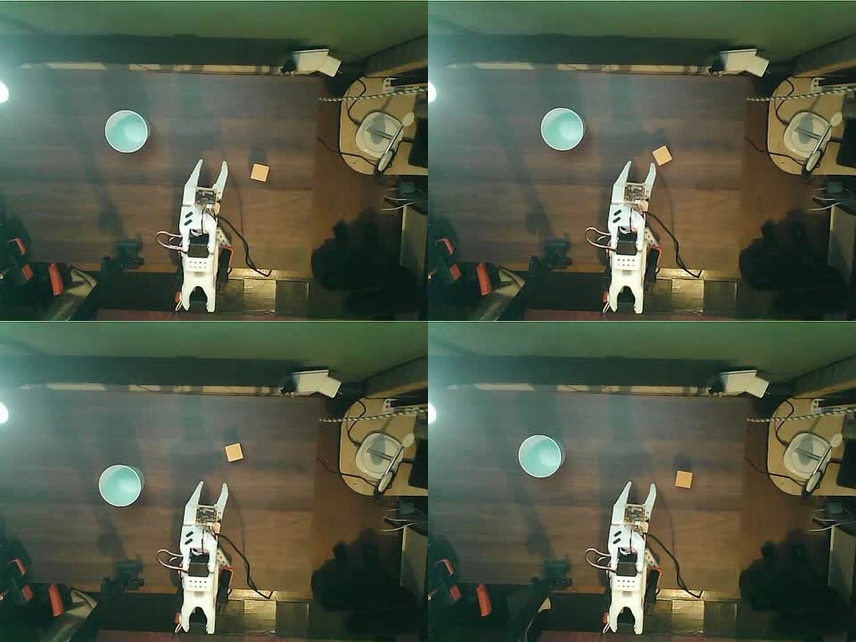<br><sub>Starting layouts of the four co-trained runs in the second session (3 successes, 1 rim bounce).</sub></p>

Policies are packaged and pushed to the Jetson with [`scripts/push_policy.py`](scripts/push_policy.py) (an optional
`so101_deploy.json` sidecar carries undistortion, start pose and speed limit). The console then runs them; see
below. [▶ step video](docs/media/videos/10_real_arm.mp4)

---

## The Jetson: `so101.sh` and the web console

Everything on the robot side runs on a Jetson Orin Nano Super (8 GB) inside a [LeRobot](https://github.com/huggingface/lerobot)
checkout (commit `b64fe1e`). [`jetson/so101.sh`](jetson/so101_web/so101.sh) is the single entry point:

| Command | What it does |
|---|---|
| `./so101.sh calibrate-leader` / `calibrate-follower` | LeRobot motor calibration for each arm ([`jetson/calibration/`](jetson/calibration)) |
| `./so101.sh teleop` | leader → follower teleoperation with both cameras (`VIEW=1` adds the Rerun viewer) |
| `./so101.sh record "task" [episodes] [name]` | LeRobot recording from the command line |
| `./so101.sh web [port]` | the web console (below) on `0.0.0.0:8080` |
| `./so101.sh rollout <policy> [seconds]` | run a trained policy with LeRobot's own `lerobot-rollout` |
| `./so101.sh policy-server <ckpt> [port]` | serve a policy from a GPU machine to the console |
| `./so101.sh prep-pi05 <dataset>` | true quantile stats for pi0.5 after recording |

The script pins both arms and both cameras by `/dev/serial/by-id` and `/dev/v4l/by-id`, resets the wrist camera's
exposure, and takes a `flock` so only one process owns the follower bus at a time.

### Web console

<p align="center">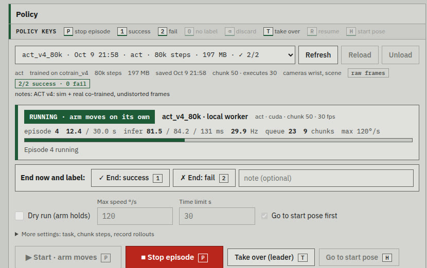<br><sub>Policy card of the console, rendered against its UI test stub (values are illustrative).</sub></p>

A dependency-free web app ([`jetson/so101_web/`](jetson/so101_web)): a stdlib HTTP server with one control thread that
owns the serial bus, and a vanilla-JS page.

- **Live views** of the wrist, overhead and depth cameras ([`depth_worker.py`](jetson/so101_web/depth_worker.py) for
  the Orbbec Astra), plus teleop and manual joint control ([`app.py`](jetson/so101_web/app.py)).
- **Recording** of teleop demos straight to LeRobot v3 datasets ([`recorder.py`](jetson/so101_web/recorder.py)).
- **Policy deployment** ([`policy_runner.py`](jetson/so101_web/policy_runner.py)): load a checkpoint, dry-run it with
  the arm holding still, then run episodes. Each run is labelled success or fail with one key, and a tally is kept per
  policy. Every real run is recorded automatically to `rollouts_<policy>` with the label and the timing quality.
- **Human in the loop:** one key hands control to the leader arm mid-episode, so real failures become correction data.
- **Real-time inference:** the policy runs in a worker process ([`policy_worker.py`](jetson/so101_web/policy_worker.py),
  [`policy_client.py`](jetson/so101_web/policy_client.py)) and serves action chunks. The scheduler overlaps inference
  with execution using latency compensation; optional temporal ensembling smooths motion.
- **Fast ACT on the Jetson** without TensorRT or new packages: fp16 plus CUDA-graph capture gives 40 ms per chunk against
  72 ms in fp32 ([`jetson_accel.py`](jetson/so101_web/jetson_accel.py), benchmarks in [`jetson/accel/`](jetson/accel)).
- **Bigger models** (GR00T, 3B) run on a cloud H100 and are served to the Jetson over an SSH tunnel (121 ms per call).
- **Safety:** STOP always wins and holds the pose with torque on; every fault ends in a hold, never a limp arm or a jump.
- **Tests:** an end-to-end suite runs the real ACT policy on the GPU against mock hardware
  ([`tests/test_e2e.py`](jetson/so101_web/tests/test_e2e.py), [`mock_hw.py`](jetson/so101_web/mock_hw.py)), plus
  scheduler and worker unit tests. The UI is checked headless against a stub ([`jetson/ui_stub/`](jetson/ui_stub)).
- Deploy from a dev machine with [`jetson/deploy.sh`](jetson/deploy.sh); it backs up the running copy, and
  `deploy.sh rollback` restores it. Design notes: [`jetson/docs/SPEC.md`](jetson/docs/SPEC.md),
  [`jetson/docs/API_NOTES.md`](jetson/docs/API_NOTES.md).

When early policies only jittered on the real arm, replaying a recorded demo reproduced the recording within 0.3°, and
the policy worker matched training-time actions. That proved the deployment path correct and put the problem in data
coverage, which steps 4–6 then fixed.

---

## Hardware

<p align="center">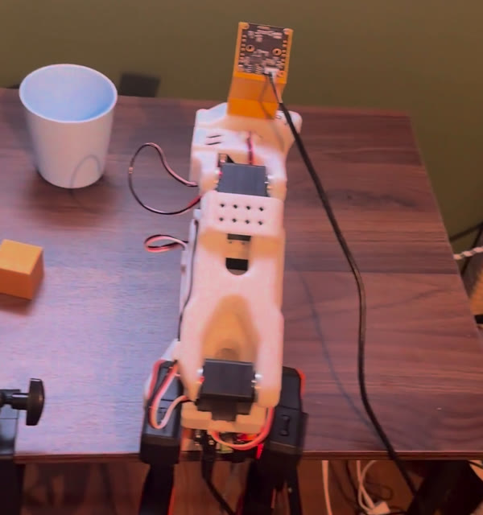</p>

| Part | Detail |
|---|---|
| Arms | SO-101 follower (12 V) + SO-101 leader (5 V) for teleoperation |
| Compute on the robot | NVIDIA Jetson Orin Nano Super, 8 GB |
| Wrist camera | Innomaker U20CAM, 640×480, 60° FOV after calibration (strong barrel distortion) |
| Overhead camera | Orbbec Astra Pro, 640×480 RGB (+ depth), about 1.4 m above the desk |
| Task objects | 30 mm wooden cube, cup |
| Training compute | NVIDIA Brev: A6000s for Isaac rendering, one H100 for training |

---

## Repository layout

```
so101_r2s2r/        Isaac Lab tasks: env configs, MDP terms, scripted expert, procedural cup, sim<->LeRobot units
scripts/            sim tools: record demos / takeovers, evaluate, replay real episodes, convert to LeRobot, push to the Jetson
calib/              camera + robot calibration (ChArUco, robot-silhouette camera pose, wrist mount, splat alignment, FK)
  data/             the resulting calibration (calib.json, intrinsics, splat pose, capture snapshots)
splat/              phone video -> frames -> COLMAP poses (gsplat trains the splat itself)
cloud/              NVIDIA Brev scripts: box setup, parallel data generation, dataset building, training, eval, GR00T
  local_3090/       the earlier single-GPU training and takeover runs
jetson/             robot side
  so101.sh          -> so101_web/so101.sh, the teleop / record / web / rollout entry point
  so101_web/        web console: app, recorder, policy runner / worker / client, Jetson ACT acceleration, tests
  accel/            ACT latency benchmarks on the Jetson
  calibration/      LeRobot motor calibration of the leader and follower arms
  ui_stub/          canned-API stub for headless UI screenshots
  docs/             console spec and API notes
analysis/           spawn-sampler checks, FK cube positions of real/sim/rollout episodes, coverage map
report/             step-video and reel builders (ffmpeg), Manim intro, CPU splat renderer
docs/               setup notes and all README media (GIFs, images, step videos)
lab.sh              runs Isaac Lab with conda/venv variables cleared
```

---

## Running it

The scripts were written for one desktop, one Jetson and a few cloud boxes, so several have absolute paths and host
names (for example `/mnt/secondary/so101_r2s` for data). Treat them as a working reference rather than a packaged
library. [`docs/SIM_NOTES.md`](docs/SIM_NOTES.md) has the full calibration and sim walkthrough.

**Robot side (Jetson, inside a LeRobot checkout):**

```bash
cp -r jetson/so101_web jetson/so101_web/so101.sh ~/lerobot/   # or jetson/deploy.sh from a dev machine (SO101_JETSON=user@host)
cd ~/lerobot
./so101.sh calibrate-follower && ./so101.sh calibrate-leader
./so101.sh teleop          # leader -> follower
./so101.sh web             # console on :8080: record demos, deploy policies, label runs
```

**Simulation (Isaac Sim 6.1 + Isaac Lab 3.0):**

```bash
./lab.sh -p scripts/run_expert.py --num_envs 64 --episodes 256 --viz none                 # expert success rate
./lab.sh -p scripts/record_demos.py --episodes 500 --preview 4 --out <dir> --viz none     # expert demos
./lab.sh -p scripts/record_takeover.py ...                                                # DAgger-style recovery data
python scripts/convert_to_lerobot.py --src <dir> --name <dataset>                         # -> LeRobot v3
```

**Train and deploy (LeRobot):**

```bash
lerobot-train --policy.type=act --dataset.repo_id=local/<dataset> --dataset.root=<path> \
  --policy.chunk_size=50 --policy.n_action_steps=30 --steps=80000 --batch_size=16
python scripts/push_policy.py ...      # package for the console (SO101_JETSON=user@host)
```

---

## What made it work

- **Simulate where the real data is thin.** The real demos leaned left, and the real-only policy failed on the right
  near the base, where it had 4 demos. Randomized sim spawns put 336 episodes there. The co-trained policy went
  19 for 21 across the desk; that exact spot is its next test.
- **Measure the gap, then close it.** Camera intrinsics, camera height, joint zeros and the wrist-mount pose were each
  measured on the real rig. Assuming them from a stock asset was wrong every time.
- **Data beats model size.** The biggest jumps came from data: a settle-based expert with more demos (+34 points),
  recovery takeovers (+22), and sim demos covering the spots the real ones miss. Swapping the model mattered less.
- **Prove the plumbing first.** Open-loop replay of a real demo, and replay through the policy worker, separated
  deployment bugs from learning failures in an afternoon.
- **Scale out where it's cheap.** Rendering ran on many cheap RT-core GPUs in parallel. Training ran on a single H100,
  where ACT steps 2.1× faster than on an A6000.

## Next

- **Real evaluation:** the co-trained policy at the exact spot where the real-only one failed, then 20 fixed, taped
  placements for both policies, with a phone side view (the console already records the robot cameras).
- **Real-world DAgger:** take over with the leader arm when a rollout fails, and fold the corrections into the next
  co-training round.
- **Harder tasks:** language-conditioned picks (which cube, which cup) with a VLA; distractors and lighting changes.

---

<sub>Built on [LeRobot](https://github.com/huggingface/lerobot), [Isaac Lab](https://github.com/isaac-sim/IsaacLab),
[gsplat](https://github.com/nerfstudio-project/gsplat), [COLMAP](https://colmap.github.io/) and the
[SO-ARM100/101](https://github.com/TheRobotStudio/SO-ARM100) design by TheRobotStudio. The intro is made with
[Manim](https://www.manim.community/). All videos are real recordings or simulator output from this project, edited
only for speed and captions.</sub>
